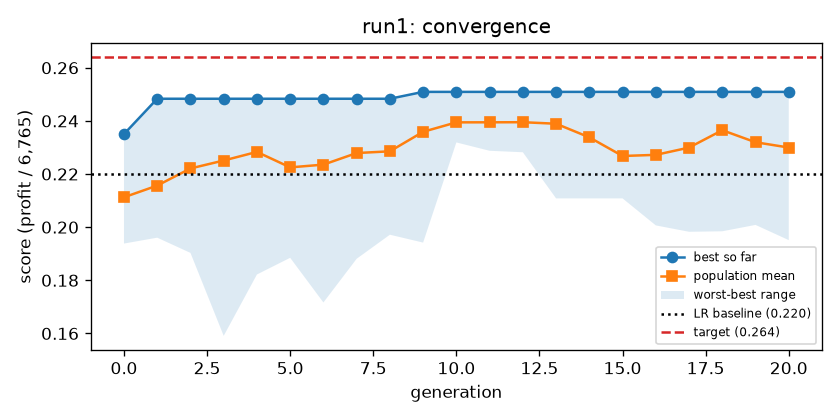

# Report — Term-deposit campaign

## Framing (short)

## Data and split (feature boundary, split decision, what you found over time)

## Evaluation design

## Baselines (profit per 1,000 clients, share called)

## Formulation (genes and fixed choices)

## Earth runs (ids, settings, champion of run1 and run2)
Both runs: the chromosome in `work/optimization/chromosome.yaml` (7 genes), population 10, 5 workers, 15-minute cap, seed-42 folds. Details in `work/runs/run1/`, `work/runs/run2/`, `work/run_notes.md`.

| Run | Earth experiment | Score used | Stopped | Champion | Profit per 1,000 (seed-42 folds) | Share called |
|---|---|---|---|---|---|---|
| run1 | `hw-run1-1792328099` | profit / 6,765 | gen 20, steady state | XGBoost, depth 6, 152 trees, learning rate 0.019, `pdays` flag on, no class weight | €1,698 ± 248 | 13.0% |
| run2 | `hw-run2-1792332632` | F1 at 0.5 | gen 14 | LR, C = 0.029, `pdays` flag on, no class weight | €1,544 ± 204 | 18.0% |

The profit-fitness champion makes €154 per 1,000 more than the F1 champion and wins all 5 folds. F1 at 0.5 only judges the few clients above 50% (mostly `poutcome = success`), while the money is made by ranking the top 13–18% well; F1 also ignores the costs.

## Analysis (guide questions 1–5)
All numbers on `train.csv` only (`work/analysis/analysis.py`, `work/analysis/results.json`). The local re-score reproduces Earth's champion (€1,697.5) and the Step 4 baseline (€1,488.8) exactly.

### 1. Did the search behave?

Healthy shape: the best score jumped from 0.235 to 0.248 in generation 1, made one small step to 0.251 at generation 9, then stayed flat until Earth's steady-state rule stopped the run at generation 20 (2 min 21 s, far below the 15-minute cap, so the run was not cut short). No errors and no floor scores in 210 candidates. The population mean rose from 0.211 to ~0.23–0.24 and stayed below the best, so the population kept some diversity. The best never approached the target (0.264).

### 2. Is the champion clearly best, or one of a crowd?
One of a crowd. The top 10 distinct candidates are within €33 per 1,000 of the champion, far less than the fold std (~€250): they are a tie.

| # | Score | Profit per 1,000 | Std | Share called | Family | Depth | Trees | Learning rate | Class weight | `pdays` flag |
|---|---|---|---|---|---|---|---|---|---|---|
| 1 | 0.251 | 1,697.5 | 248 | 13.0% | XGBoost | 6 | 152 | 0.019 | no | yes |
| 2 | 0.250 | 1,692.5 | 225 | 13.0% | XGBoost | 6 | 152 | 0.018 | no | yes |
| 3 | 0.249 | 1,682.5 | 228 | 13.2% | XGBoost | 6 | 151 | 0.019 | no | yes |
| 4 | 0.248 | 1,680.0 | 213 | 13.0% | XGBoost | 6 | 162 | 0.014 | no | yes |
| 5 | 0.248 | 1,678.8 | 221 | 13.5% | XGBoost | 6 | 163 | 0.014 | no | yes |

Gap from the champion: #2 €5, #5 €19, #10 €33. All ten agree on XGBoost, no class weight, `pdays` flag on, depth 5–6, ~150–160 trees and a small learning rate (0.014–0.019). That agreement is what the search learned; the exact values inside it did not matter. Per fold, the champion beats LR in 4 of 5 folds (+225, −56, +244, +575, +56).

### 3. Which decisions mattered?
Gene shifts, first 3 vs last 3 generations: `model_family` XGBoost 50% → 67%; `xgb_max_depth` = 6 from 27% → 63%; `class_weight_balanced` = false from 50% → 77%; `pdays_flag` unchanged (67% on). `lr_C_exponent` only matters for LR candidates, so its values in the XGBoost winners are hitchhikers.

One-flip checks (champion, seed-42 folds, change in profit per 1,000):

| Change | Profit per 1,000 | Change |
|---|---|---|
| champion | 1,697.5 | — |
| model family → LR (C = 1) | 1,481.2 | −216 |
| class weight on | 1,558.8 | −139 |
| `pdays` flag off | 1,585.0 | −113 |
| depth 6 → 8 (outside the range) | 1,587.5 | −110 |
| depth 6 → 4 | 1,658.8 | −39 |

The genes that mattered most: **model family** (XGBoost over LR, −€216 when switched), **class weight off** (−€139 when on: upweighting subscribers spoils the ranking at the top of the list), and the **`pdays` flag** (−€113 when off, even though it mostly repeats `poutcome`). Depth matters less: 6 sits at the top of the range, but 8 is clearly worse, so the range limit did not hold the search back.

### 4. How optimistic is the search score?
Re-scored with the same fitness on fresh fold seeds 1–5 (outer and inner folds both re-drawn):

| | Search (seed 42) | Fresh seeds 1–5 (mean) | Per seed |
|---|---|---|---|
| Champion | €1,697.5 | €1,721.2 | 1,689 / 1,699 / 1,739 / 1,716 / 1,764 |
| LR baseline | €1,488.8 | €1,542.8 | 1,546 / 1,574 / 1,576 / 1,515 / 1,503 |
| Gain | €208.8 | **€178.5** | +143 / +125 / +163 / +201 / +261 |

No sign of search optimism: the champion does not drop on fresh folds (the seed-42 folds were a little harder than average for both models). The gain over LR is real (positive on every seed, spread ~€50) but smaller on fresh folds, **€179 per 1,000, below the €300 success margin**.

### 5. What is it worth, and how sure are we about the money?
Per 10,000 clients (seed-42 validation folds, scaled):

| Policy | Calls | Subscriptions | Profit |
|---|---|---|---|
| Call everyone | 10,000 | 1,128 | −€21,075 |
| LR baseline | 1,180 | 381 | €14,888 |
| Champion | 1,295 | 428 | €16,975 |

**The call list.** The champion calls 13% of clients, of whom 33% subscribe (base rate 11.3%). Compared with all clients, the list is 97% cellular (vs 63%), 26% previous-campaign success (vs 3%), over-weights students (11% vs 2%) and retired clients (18% vs 4%), and takes the young (≤30: 38% vs 18%) and the old (51+: 43% vs 18%), the U-shape in age that LR cannot model. A marketing manager would recognise this list.

**Sensitivity to the money** (same models, share re-picked on the training part):

| Cost per call, value per subscription | Champion | Baseline | Gain | Folds won | Share called |
|---|---|---|---|---|---|
| €10, €70 (base) | 1,698 | 1,489 | +209 | 4/5 | 13% |
| €8, €70 | 2,072 | 1,970 | +101 | 3/5 | 30% |
| €12, €70 | 1,419 | 1,362 | +57 | 3/5 | 11% |
| €10, €50 | 906 | 898 | +9 | 3/5 | 9% |
| €10, €90 | 2,789 | 2,654 | +135 | 2/5 | 40% |

The champion stays ahead of the baseline in every scenario, but the gain shrinks to almost nothing at €50 per subscription and is never above the base case. The share to call moves a lot with the money (9% to 40%), because the profit curve is flat around its maximum.

**The share called** per fold (picked on the training part): 15.4%, 13.0%, 9.6%, 14.8%, 12.0%; the share that would have been best in hindsight on each validation fold: 9.3%, 9.4%, 10.2%, 14.8%, 14.2%. The rule is in the right range but misses by up to 6 points on single folds, which is part of the fold-to-fold noise.

**Calibration (stretch).** Among baseline out-of-fold scores between 12% and 17% (mean predicted 14.1%), 13.0% actually subscribe: close, slightly over-confident. A fixed 14.3% cut-off would be roughly in the right place for the baseline, but picking the share on the training folds does not depend on it.

**Robustness, in one sentence:** the champion's lead over logistic regression is consistent (every fresh seed, every money scenario) but modest, €179 per 1,000 on fresh folds, below the €300 bar set in framing, and it shrinks when a subscription is worth less.

## Test read (one table: call everyone, simple rule, baseline, champion)

## Verdict against the success criterion

## What would you let Earth evolve in your next experiment, and why?
